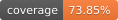

# Spyglass: Keeping an Eye on Apple Containers

[](#requirements)
[](#requirements)
[](LICENSE)
[](#requirements)
[](#coverage)

Spyglass is a **one-shot** command-line tool that keeps selected Apple Containers running and updates them to the latest version of their image. It is not a daemon; schedule it with a macOS LaunchAgent (see below) if you want it to run periodically or at login.

## Requirements

- macOS with Apple's container command-line tool installed and its container service configured
- Python 3.12 or newer for source or PyPI installs; Homebrew installs Python
  for you
- Apple's container executable available on PATH when Spyglass runs

## Install with Homebrew

This project is distributed from a custom Homebrew tap. Add the tap once, then
install the command:

```shell
brew tap wolfpaulus/spyglass https://github.com/wolfpaulus/spyglass
brew install spyglass
spyglass
```

Alternatively, install from PyPI with Python 3.12 or newer:

```shell
python3 -m pip install apple-container-spyglass
spyglass
```

Or clone the GitHub repository and run Spyglass directly:

```shell
git clone https://github.com/wolfpaulus/spyglass.git
cd spyglass
python3 spyglass.py
```

## Choose containers to manage

Spyglass only manages containers labeled `spyglass=true`. Add that label when
creating a container:

```shell
container run --detach --name my-app \
  --label spyglass=true \
  docker.io/library/nginx:latest
```

To manage an existing container, recreate it with the label. For each labeled
container Spyglass pulls its configured image, compares image digests, and
recreates it if the image changed. Updates briefly interrupt the container.
Stopped labeled containers are started. After an update, the old image is
removed by default; add the label `spyglass_rmi=false` to keep it.

Container configuration is reconstructed from Apple Container's inspect data. The effective environment is saved under ~/Library/Application Support/Spyglass/env. To override environment values, set **spyglass_env_file** to the path of a standard KEY=value file; its values take precedence over the captured environment. These files may contain secrets, so keep them private and do not commit them.

## Logging

Spyglass writes a rotating log to ~/Library/Logs/Spyglass

## Run periodically

To run Spyglass periodically, create a LaunchAgent (example below). For a
Homebrew or PyPI installation, use the absolute path returned by
`command -v spyglass`. For a GitHub checkout, use the absolute paths to Python
and `spyglass.py`. launchd does not expand `~` or `$HOME`.

LaunchAgents have a limited `PATH`. Include the directory containing Apple's
`container` executable; find it with `command -v container`. Adjust the
example's `PATH` if your installation uses a different location.

Run it as the same user who owns the containers; **do not run it as root.**

## Launch Agent

Save as `~/Library/LaunchAgents/com.wolfpaulus.spyglass.plist`. Replace the
example executable path with the absolute path returned by `command -v
spyglass`.

```xml
<?xml version="1.0" encoding="UTF-8"?>
<!DOCTYPE plist PUBLIC "-//Apple//DTD PLIST 1.0//EN"
 "http://www.apple.com/DTDs/PropertyList-1.0.dtd">
<plist version="1.0">
<dict>
    <key>Label</key>
    <string>com.wolfpaulus.spyglass</string>

    <key>ProgramArguments</key>
    <array>
        <string>/opt/homebrew/bin/spyglass</string>
    </array>

    <key>EnvironmentVariables</key>
    <dict>
        <key>PATH</key>
        <string>/opt/homebrew/bin:/usr/local/bin:/usr/bin:/bin</string>
    </dict>

    <key>RunAtLoad</key>
    <true/>

    <key>StartInterval</key>
    <integer>3600</integer>
</dict>
</plist>
```

For a GitHub checkout, replace the `ProgramArguments` array with the absolute
paths to your Python interpreter and `spyglass.py` script. Find the paths with
`command -v python3` and `pwd` from the checkout:

```xml
<array>
    <string>/opt/homebrew/bin/python3</string>
    <string>/Users/yourname/path/to/spyglass/spyglass.py</string>
</array>
```

Create the LaunchAgents directory if needed, then load the job:

```shell
mkdir -p ~/Library/LaunchAgents
launchctl bootstrap "gui/$(id -u)" \
  "$HOME/Library/LaunchAgents/com.wolfpaulus.spyglass.plist"
```

This is a one-shot job, so it does not need `KeepAlive`. Adjust `StartInterval`
if an hourly check is not appropriate.

And don't worry, launchd will never launch a second overlapping instance of the LaunchAgent when StartInterval triggers while the previous run is still active.
