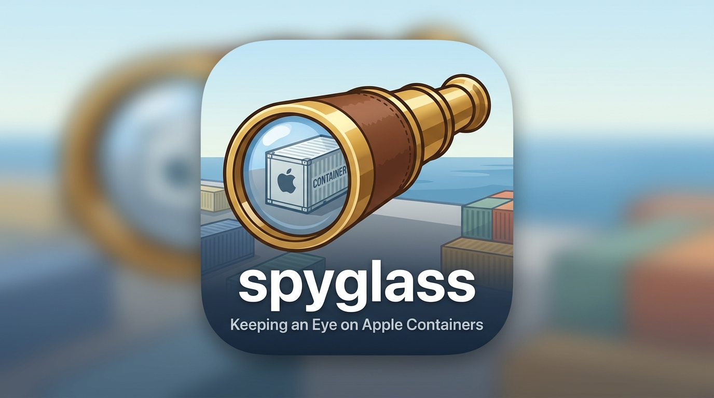

# Spyglass: Keeping an Eye on Apple Containers

[](#requirements)
[](#requirements)
[](LICENSE)
[](#requirements)
[](#coverage)

Spyglass is a **one-shot** command-line tool that keeps selected Apple Containers running and updates them to the latest version of their image. It is not a daemon; schedule it with a macOS LaunchAgent (see below) if you want it to run periodically or at login.

## Requirements

- macOS with Apple's container command-line tool installed and its container service configured
- Python 3.12 or newer for source or PyPI installs; Homebrew installs Python
  for you
- Apple's container executable available on PATH when Spyglass runs

## Install with Homebrew

This project is distributed from a custom **Homebrew tap.** Add the tap once, then install the command. And yes, brew update/upgrade will work for this tap too.

```shell
brew tap wolfpaulus/spyglass https://github.com/wolfpaulus/spyglass
brew trust --formula wolfpaulus/spyglass/spyglass
brew install spyglass
spyglass
```

You should get something like this:

```text
To start wolfpaulus/spyglass/spyglass now and restart at login:
  brew services start wolfpaulus/spyglass/spyglass

Or, if you don't want/need a background service you can just run:
  /opt/homebrew/opt/spyglass/bin/spyglass
```

**Alternatively,** install from PyPI with Python 3.12 or newer:

```shell
python3 -m pip install apple-container-spyglass
spyglass
```

**Or clone the GitHub repository** and run Spyglass directly:

```shell
git clone https://github.com/wolfpaulus/spyglass.git
cd spyglass
python3 spyglass.py
```

## Choose containers to manage

Spyglass only manages containers labeled `spyglass=true`. Add that label when
creating a container:

```shell
container run --detach --name my-app \
  --label spyglass=true \
  docker.io/library/nginx:latest
```

To manage an existing container, recreate it with the label. For each labeled
container Spyglass pulls its configured image, compares image digests, and
recreates it if the image changed. Updates briefly interrupt the container.
Stopped labeled containers are started. After an update, the old image is
removed by default; add the label `spyglass_rmi=false` to keep it.

Container configuration is reconstructed from Apple Container's inspect data. The effective environment is saved under ~/Library/Application Support/Spyglass/env. To override environment values, set **spyglass_env_file** to the path of a standard KEY=value file; its values take precedence over the captured environment. These files may contain secrets, so keep them private and do not commit them.

## Logging

Spyglass writes a rotating log to ~/Library/Logs/Spyglass

## Run periodically

For a Homebrew installation, let Homebrew manage the scheduled LaunchAgent:

```shell
brew services start spyglass
```

This runs Spyglass when you log in and then once per hour. To stop the scheduled
job:

```shell
brew services stop spyglass
```

The interval is set in the Homebrew formula. To change it locally, run
`brew edit spyglass` and change `interval 3600` in the `service` block; the
value is in seconds (for example, `900` runs every 15 minutes). Apply the
change by restarting the service:

```shell
brew services restart spyglass
```

This local formula edit may be overwritten when you update the tap. To keep a
custom interval across updates, maintain your own tap or use a manually
configured LaunchAgent.

Run it as the same user who owns the containers; **do not use `sudo`**. The
service uses Homebrew's standard `PATH`. If Apple's `container` command is
installed somewhere else, add its directory to `PATH` in
`~/.homebrew/services/spyglass.env`, then restart the service.

For a GitHub checkout, save the following as
`~/Library/LaunchAgents/com.wolfpaulus.spyglass.plist`. Replace the example
Python and script paths with absolute paths on your Mac; launchd does not
expand `~` or `$HOME`. Include the directory containing Apple's `container`
command in `PATH`.

```xml
<?xml version="1.0" encoding="UTF-8"?>
<!DOCTYPE plist PUBLIC "-//Apple//DTD PLIST 1.0//EN"
 "http://www.apple.com/DTDs/PropertyList-1.0.dtd">
<plist version="1.0">
<dict>
    <key>Label</key>
    <string>com.wolfpaulus.spyglass</string>

    <key>ProgramArguments</key>
    <array>
        <string>/opt/homebrew/bin/python3</string>
        <string>/Users/yourname/path/to/spyglass/spyglass.py</string>
    </array>

    <key>EnvironmentVariables</key>
    <dict>
        <key>PATH</key>
        <string>/opt/homebrew/bin:/usr/local/bin:/usr/bin:/bin</string>
    </dict>

    <key>RunAtLoad</key>
    <true/>

    <key>StartInterval</key>
    <integer>3600</integer>
</dict>
</plist>
```

Create the LaunchAgents directory if needed, then load the job:

```shell
mkdir -p ~/Library/LaunchAgents
launchctl bootstrap "gui/$(id -u)" \
  "$HOME/Library/LaunchAgents/com.wolfpaulus.spyglass.plist"
```

This is a one-shot job, so it does not need `KeepAlive`. Adjust `StartInterval`
if an hourly check is not appropriate.

And don't worry, launchd will never launch a second overlapping instance of the LaunchAgent when StartInterval triggers while the previous run is still active.
